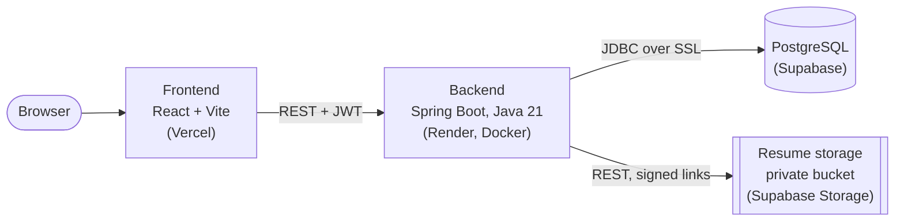
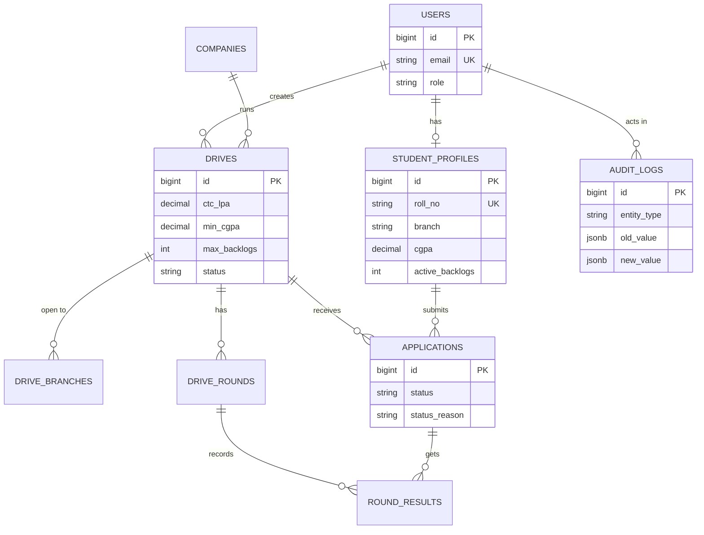

# PlacementHub

**A campus placement portal that checks every application against the drive's criteria and the college's placement policies, and gives a clear reason whenever it says no.**

[](https://github.com/Samarpan-algo/placementhub/actions/workflows/ci.yml)

| | |
| --- | --- |
| **Live demo** | <https://placementhub-navy.vercel.app> |
| API (not a website) | <https://placementhub-api-3gjm.onrender.com> ([health check](https://placementhub-api-3gjm.onrender.com/api/health)) |

> **The first load can take about a minute.** The app runs on free tiers, and the API sleeps after ~15 minutes without traffic.
> To try it, register as a student. The admin account isn't public.

## The problem

Most tier-2/3 colleges in India run placements through WhatsApp groups, Google Forms and Excel. Eligibility shortlisting is done by hand and goes wrong, rules like "one offer per student" are applied inconsistently, and when a drive's criteria change midway, nobody can prove who was affected or why.

PlacementHub makes every application decision **automatic, explainable and auditable**.

## Key features

### For students

- Register, log in, upload a PDF resume
- Browse open drives, with an "eligible only" filter that shows why you're not eligible
- Apply, and see the exact reason if you're blocked
- Withdraw before the registration deadline
- Track each application round by round

### For the TPO admin

- Manage companies and drives (draft → open → closed → completed)
- Filter applicants by status, branch and CGPA; export them to CSV
- Add interview rounds, record results in bulk, select final candidates
- Turn placement policies on and off and set their limits
- Read the audit log and a stats dashboard (placement %, offers per company, CTC)

### What makes it more than CRUD

| Feature | How it works |
| --- | --- |
| **Placement policy engine** | `ONE_OFFER`, `DREAM_OFFER` (one upgrade if the new CTC ≥ a threshold) and `MAX_OFFERS`, built with the **Strategy pattern**: each rule is its own class behind a `PolicyRule` interface, and admins change the settings at runtime. Policies are checked at apply time and again at selection time. |
| **Criteria-change re-evaluation** | When an admin tightens an open drive's criteria, every pending application is re-checked with the same `EligibilityService` used for applying. Those that fail become `INELIGIBLE`, with the reason. |
| **Audit log** | Criteria edits, application status changes and policy changes are recorded with who, what, old → new and when. The audit row is written in the **same transaction** as the change, so they commit or roll back together. |
| **Duplicate-safe applies** | A database `UNIQUE(drive_id, student_id)` constraint is the real guard. If two requests race past the "already applied?" check, the insert fails and the API returns a clean **409**, not a 500. |
| **Explainable rejections** | Eligibility checks all 6 rules and returns **every** failing reason with real numbers (for example "Minimum CGPA is 7.00; yours is 6.80"), not just the first one. |

## Architecture



The backend is organised **by feature** (`drive`, `application`, `policy`, `audit`, …), each layered as controller → service → repository. Business rules live only in services, and controllers only see DTOs.

### Data model (main tables)



`applications` has `UNIQUE(drive_id, student_id)`. `placement_policies` (one row per policy type) is left out of the diagram. The full schema is in [V1__init.sql](backend/src/main/resources/db/migration/V1__init.sql).

### Tech stack

| Layer | Technology |
| --- | --- |
| Backend | Java 21, Spring Boot 4, Spring Web, Spring Data JPA, Spring Security + JWT, Bean Validation, Flyway |
| Database | PostgreSQL 17 (Docker locally, Supabase in production) |
| Frontend | React 19 + Vite, React Router, axios, plain CSS |
| Testing | JUnit 5, Mockito, MockMvc, Postman/Newman |
| DevOps | Docker, GitHub Actions, Render, Supabase, Vercel |

## Engineering highlights

- **A timezone bug:** a deadline of 3 Dec 02:00 IST is still 2 Dec in UTC, so a wrong drive date was accepted. Date rules now compare IST days ([decision 72](docs/decisions.md#72-the-drive-date-check-compares-days-in-ist-not-utc)).
- **Upload consistency without a shared transaction:** a DB transaction can't roll back a file in storage, so uploads go store new file → swap the path under a row lock → delete the old file, and the DB never points at a missing file ([decision 93](docs/decisions.md#93-upload-order-store-the-new-file-swap-the-path-under-a-row-lock-then-delete-the-old-file)).
- **Production safety:** demo accounts (with a public password) never reach production, the app refuses to start without its secrets, and the first admin is created from environment variables ([decisions 105–108](docs/decisions.md#105-the-demo-seed-runs-only-in-dev-and-test-policies-are-reference-data-v5)).
- **One source of truth for rules:** the same `EligibilityService` decides browse, apply and criteria re-evaluation, and the same `PolicyEngine` decides apply and selection, so the rules can't drift apart.
- **Test isolation:** tests run on a separate `placementhub_test` database with fake resume storage, and a guard test fails if they ever point anywhere else ([decision 98](docs/decisions.md#98-a-separate-test-database-through-a-test-profile-resolves-decision-79)).
- **Flyway on Supabase:** the first deploy failed because Supabase pre-creates a function in `public`. A one-time baseline at version 0 fixed it while keeping Supabase's row-level security protection ([decision 110](docs/decisions.md#110-first-start-on-supabase-flyway-baseline-at-version-0-keeping-supabases-auto-rls-function)).
- **Safe CSV export:** every cell is escaped against spreadsheet formula injection ([decision 56](docs/decisions.md#56-csv-export-every-cell-escaped-against-formula-injection-phone-column-included)).

## Screenshots

<!-- TODO: add screenshots (student drive list with eligibility reasons, apply rejection, admin applicants, policies, audit log, stats). -->

## Run locally (Windows, PowerShell)

You need **JDK 21**, **Docker Desktop** (running), **Node.js 20.19+** and Git. Maven comes with the repo (`mvnw.cmd`).

```powershell
# 1. Database
Copy-Item .env.example .env
docker compose up -d

# 2. Backend (http://localhost:8080/api/health should show "UP")
cd backend
.\mvnw.cmd spring-boot:run

# 3. Frontend, in a second terminal (http://localhost:5173)
cd frontend
npm install
npm run dev
```

Locally, Flyway loads demo data. Log in as `admin@placementhub.dev` or `aarav.sharma@student.placementhub.dev`, password `Demo@1234`. These accounts exist **only locally**, never in production.

Resume upload needs Supabase values in `.env`; without them everything else works and resume endpoints return 503. All settings are in [`.env.example`](.env.example) and the [deploy runbook](docs/deploy.md).

## Testing

**601 backend tests** (unit, MockMvc API and repository tests), all passing, plus a Postman collection of 290 assertions.

Tests run against a separate database, so your dev data is never touched. Create it once (Docker running):

```powershell
docker exec placementhub-postgres psql -U placementhub -d postgres -c "DROP DATABASE IF EXISTS placementhub_test WITH (FORCE)" -c "CREATE DATABASE placementhub_test"

cd backend
.\mvnw.cmd test
```

The Postman collection runs against the app on the test database (port 8081):

```powershell
# Terminal 1
cd backend
.\mvnw.cmd spring-boot:run "-Dspring-boot.run.profiles=test"

# Terminal 2
npx newman run postman\PlacementHub.postman_collection.json
```

GitHub Actions runs the backend tests (with a Postgres service) and the frontend build on every push.

## Known limitations

v1 is deliberately small. Each item has a decision entry with the reasoning.

- **Free-tier hosting:** the API sleeps when idle, and the backend (Singapore) is ~100 ms from the database (Sydney) per query.
- **Auth:** the JWT lives in `localStorage` (an XSS trade-off), there's no logout revocation, no password reset and no login rate limiting.
- **Criteria re-evaluation is one-way:** loosening criteria doesn't restore `INELIGIBLE` applications, and there's no "un-select".
- **"Eligible only" browsing filters in memory,** which is fine for the tens of open drives a college has, not for thousands.
- **The audit log shows IDs, not names** (for example "Application #12").
- **Selection has no policy preview:** a policy block shows up as a 409 after you confirm.
- **The duplicate-apply race is tested with a mocked constraint error,** not yet with a real load test.

## Roadmap (v2)

- Recruiter role, so companies manage their own drives
- Email notifications for results and deadlines
- Refresh tokens, logout revocation, password reset, login rate limiting
- LLM-based extraction of eligibility criteria from job description PDFs
- A k6 load test of concurrent applies

## More docs

- [Design decisions](docs/decisions.md): 111 decisions, each with alternatives and reasons
- [Learning log](docs/learning-log.md): what I learned in each milestone
- [Milestone history](docs/milestone-history.md): what each milestone delivered
- [Deploy runbook](docs/deploy.md): Supabase, Render and Vercel step by step
